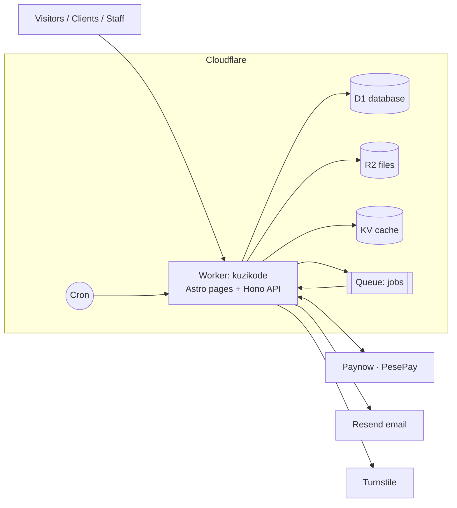
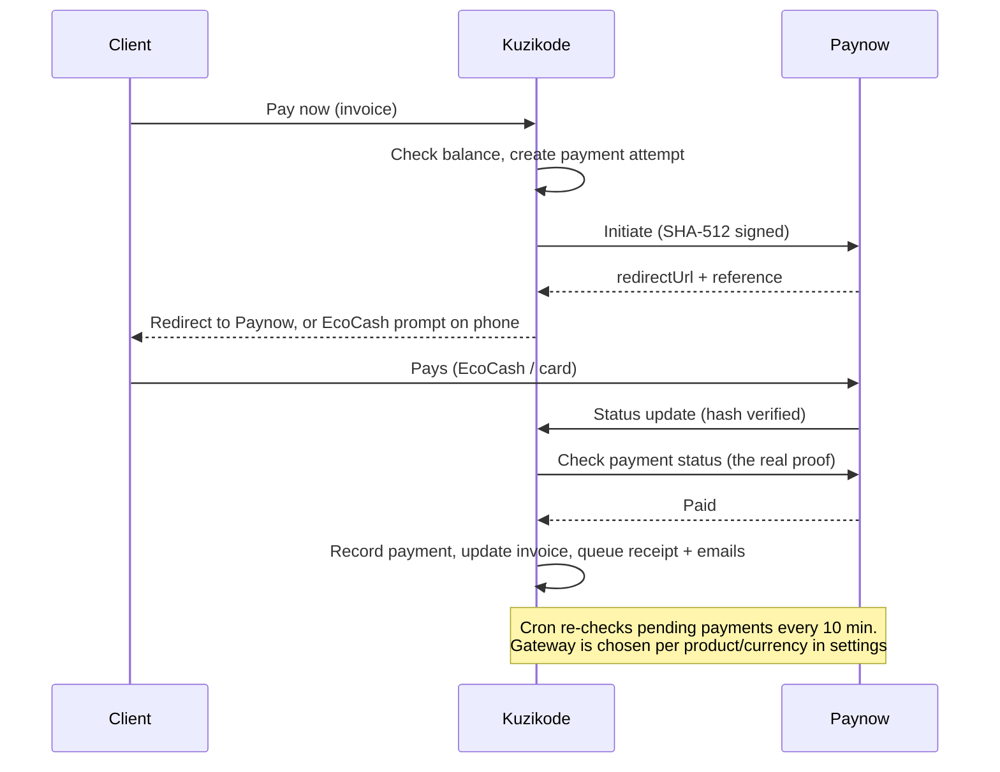
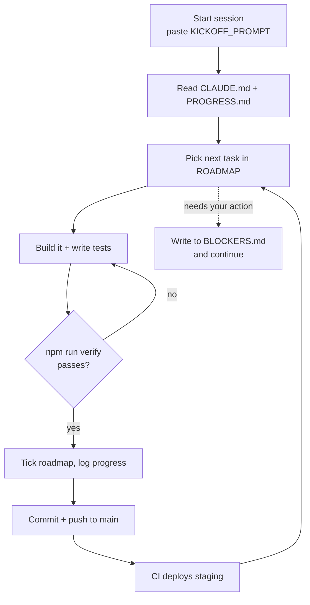
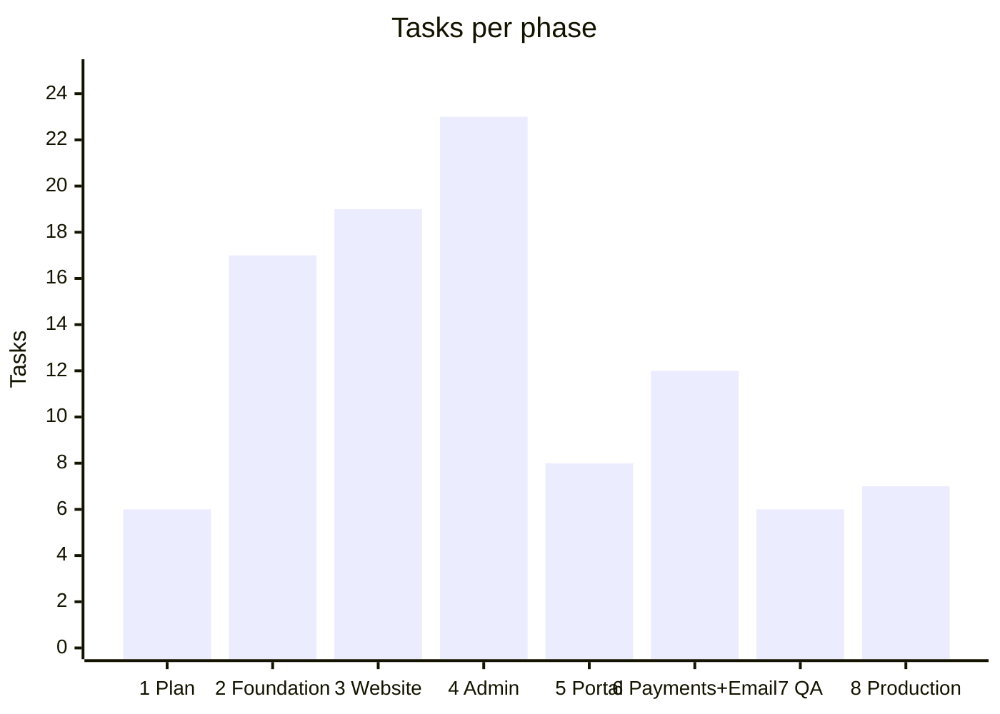

# Kuzikode Platform: Project Snapshot

> One-page overview of the autonomous build plan for the Kuzikode Technologies platform.
> Planned 5 Nov 2026. The full specs live in the dev pack (`CLAUDE.md` + `docs/`).

---

## 1. What is being built

One integrated platform, one codebase, deployed as a single Cloudflare Worker:

| Part | URL | Who uses it |
|---|---|---|
| Public company website | `/` | Visitors, prospective clients |
| Admin portal | `/admin` | You and your staff (6 roles) |
| Client portal | `/portal` | Your clients (invite only) |
| Public document links | `/q/…` quotes · `/i/…` invoices | Clients without logging in |

**Modules:** clients & leads · enquiries · service catalogue · **priced packages & care plans** ·
quotations · invoicing (partial payments, credit notes, reminders) · **subscriptions / recurring billing** ·
gateway-independent payments (Paynow at launch) · projects & milestones · **time tracking** · expenses · **careers & recruitment** ·
website CMS · **insights blog** · notifications & email · reports · audit logs · **2FA**.

**Extra website pages:** Pricing · Start-a-Project wizard · Industries (8) · Insights (blog) · How we work ·
FAQ · Careers · WhatsApp chat button · consultation booking · newsletter.

**Not built:** Kuzikode Business Suite (shown only as "In Development" on the Products page).

**Website:** six service divisions. Web Development · Mobile & Desktop Apps · Business Software ·
AI & Data · Automation & Integration · Cloud & IT.

---

## 2. Platforms chosen

| Need | Platform | Free tier | Notes |
|---|---|---|---|
| Hosting | **Cloudflare Workers** | 100k requests/day | `workers.dev` URL first, `kuzikode.com` later |
| Database | **Cloudflare D1** (SQLite) | 5 GB | Chosen over MongoDB: invoices and payments need strict relational integrity |
| File storage | **Cloudflare R2** | 10 GB | PDFs, uploads, deliverables, backups. Needs a card on file ($0) |
| Cache | **Cloudflare KV** | 1k writes/day | Low-write cache only |
| Background jobs | **Cloudflare Queues** + cron | 10k ops/day | Emails, PDFs, reminders, payment checks |
| Email | **Resend** | 3,000/month · 100/day | Needs domain DNS verification to send from @kuzikode.com |
| Spam protection | **Cloudflare Turnstile** | Free | Contact, login, reset forms |
| Payments | **Paynow** (launch) · PesePay ready | Test mode free | EcoCash, OneMoney, InnBucks, cards. Gateway-independent: switching or adding a gateway = settings change |
| PDFs | **pdf-lib** (in code) | Free | Quotes, invoices, receipts, credit notes |
| Site images | **Cloudflare Workers AI** (Leonardo / FLUX models) | Free | ~20 AI images (people, offices, objects) generated once during development, Cassava-style. Canva as backup |
| Code & CI/CD | **GitHub + Actions** | Free / 2,000 min | Push to `main` → auto-deploy to staging |
| Frontend | **Astro + React + Tailwind** | n/a | |
| API | **Hono + Zod** | n/a | |

**Monthly cost at launch: $0.** Recommended before taking real payments: **Workers Paid, $5/month**.
The free plan limits each request to 10 ms of processing, which PDFs and logins can exceed.

---

## 3. How it fits together

---

## 4. How a payment works

Safety rules: the browser's return page never counts as proof of payment. Duplicate callbacks produce
only one payment. Amount and currency must match. Money is stored as whole cents, never decimals.

---

## 5. How the agent works

- It never asks you questions. It decides and records each decision in `docs/DECISIONS.md`.
- Before a session ends it writes a precise "Next step" so the next session resumes.
- It stops only when all 98 tasks are done and `docs/FINAL-REPORT.md` is written.

### Roadmap: 98 tasks in 8 phases

### Design tools
| Tool | Used for | Status |
|---|---|---|
| pen.dev | Mockups of 6 key screens before coding (max 12 runs) | Needs `PEN_CLI_KEY` + `CLAUDE_CODE_OAUTH_TOKEN` (Claude Pro plan) |
| Canva | Logo ideas, social share images, email header | ✅ Connected |
| Figma | Review copy of screens for you | ⚠️ View seat: 20 calls/month, may not be able to edit |

---

### Website plans (suggested launch prices, USD; you confirm before they go public)

| Starter Website | Business Website ★ | E-commerce Store | Custom Web App |
|---|---|---|---|
| $350 · up to 5 pages · 2 mailboxes · domain + hosting yr 1 | $750 · up to 12 pages · CMS · **10 business emails** · blog · SEO | from $1,500 · shop up to 100 products · EcoCash/card payments | Custom quote |

Care plans: Essential $25/mo · Business $60/mo · Growth $150/mo. Business email: $3/mailbox/month (Zoho basis).
Full catalogue for all six divisions: `docs/12-COMMERCIAL-FEATURES.md`.

### Imagery rules
AI-generated people are **illustrative only**: never presented as staff, clients or testimonials. Real team photos only from you.

## 6. How to prompt the agent

1. Open **claude.ai/code**, select the repo, start a session.
2. Paste the contents of **`KICKOFF_PROMPT.md`**. The same prompt starts the work and resumes it.
3. When a session ends, paste it again. Or create a **recurring scheduled task** (e.g. every 3 hours)
   with that prompt so it continues automatically.
4. To steer it, add one line after the prompt, e.g. *"Prioritise P3 (public website) next."*
   For a permanent change, edit `docs/01-PRD.md`.

Where to check progress:
- `docs/PROGRESS.md`: session log
- `docs/10-ROADMAP.md`: ticked tasks
- GitHub commits
- Staging URL (once deployed)

---

## 7. Your to-do list

### Once, before the first session (~30 min)
- [ ] Create a private GitHub repo and copy the dev pack into its root on `main` (no branch protection)
- [ ] Create a Cloudflare account, enable R2, create an API token (scopes in `docs/BLOCKERS.md`)
- [ ] GitHub → Secrets: `CLOUDFLARE_API_TOKEN`, `CLOUDFLARE_ACCOUNT_ID`, `BACKUP_ENCRYPTION_PASSPHRASE`
- [ ] GitHub → Environments: create `production` with yourself as required reviewer
- [ ] Claude Code environment: allow internet access, add the same Cloudflare variables, set permission mode to auto

### When convenient (the agent builds around these)
- [ ] Resend account → `RESEND_API_KEY`
- [ ] Paynow merchant + test integration → `PAYNOW_USD_INTEGRATION_ID`, `PAYNOW_USD_INTEGRATION_KEY`, `PAYNOW_TEST_AUTHEMAIL`
- [ ] Turnstile site → site key + `TURNSTILE_SECRET_KEY`
- [ ] pen.dev developer key + Anthropic API key (optional, for mockups)
- [ ] Add **Workers AI** permission to the Cloudflare token (for free image generation)
- [ ] WhatsApp business number · optional Cal.com booking link

### Later
- [ ] Register **kuzikode.com**, add it to Cloudflare, verify it in Resend
- [ ] Paynow **"Request to be Set Live"** after test payments pass
- [ ] Legal review of privacy policy and terms. Confirm company registration and VAT status
- [ ] **Review package prices**, then switch on "Show prices"
- [ ] Choose the business email provider (Zoho or Google) for client mailboxes
- [ ] Upgrade to Workers Paid ($5/month) before real payments
- [ ] Approve production deploys (one click in GitHub Actions)
- [ ] Check `docs/BLOCKERS.md` now and then

---

## 8. Key rules built into the plan
- Never fake clients, testimonials, stats or projects. The portfolio starts empty.
- Never claim the company is registered, or that payments are live, until it's true.
- Issued invoices are never edited or deleted. Corrections use void and credit notes.
- Secrets never go in code. The first admin is created with a one-time 24-hour link.
- Admin and portal pages are never indexed or cached. Clients see only their own records.
- Backups: nightly encrypted database export to R2, plus D1 Time Travel. The restore is tested.

## 9. Dev pack files
`CLAUDE.md` (agent rules) · `KICKOFF_PROMPT.md` · `OWNER-SETUP.md` · `docs/01-PRD` · `02-TECH-DECISIONS` ·
`03-ARCHITECTURE` · `04-DATABASE` · `05-DESIGN-SYSTEM` · `06-PAYMENTS` · `07-SECURITY` · `08-TESTING` ·
`09-DEPLOYMENT` · `10-ROADMAP` · `11-DESIGN-TOOLS` · `12-COMMERCIAL-FEATURES` · `13-IMAGERY` · `PROGRESS` · `DECISIONS` · `BLOCKERS` · `.claude/skills/pen-design`
